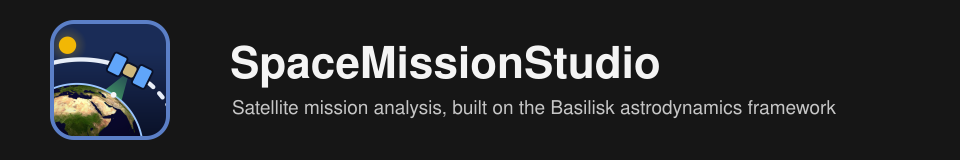
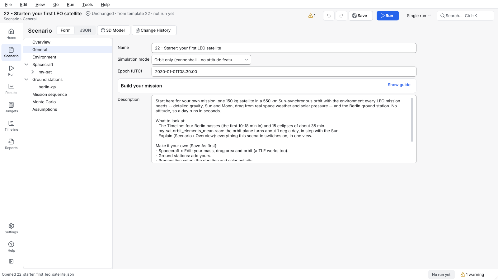

<p align="center">
  
</p>

# SpaceMissionStudio

[](https://github.com/0h3xn4/basilisk_space-mission-studio/actions/workflows/spacemissionstudio.yml)
[](https://github.com/0h3xn4/basilisk_space-mission-studio/releases/tag/spacemissionstudio-v2.16.0)


SpaceMissionStudio is a desktop app for satellite mission analysis. You
design a mission in forms, run it and read the results, without code.
[Basilisk](https://github.com/AVSLab/basilisk), the astrodynamics
framework of the AVS Lab, calculates every number.

This repository is a fork of Basilisk. The app is in
[`SpaceMissionStudio/`](SpaceMissionStudio/README.md). Basilisk is not
changed: its README is [below](#original-basilisk-readme).



## Install

| System | Get | Install |
|---|---|---|
| Linux x86_64 | The `.deb` from the [releases page](https://github.com/0h3xn4/basilisk_space-mission-studio/releases) | `sudo apt install ./spacemissionstudio_<version>_amd64.deb` |
| Windows 10 or 11 | The setup program from the [releases page](https://github.com/0h3xn4/basilisk_space-mission-studio/releases) | Double-click `spacemissionstudio-<version>-setup.exe` |
| From source, Python 3.14 | A clone of this repository, in its `SpaceMissionStudio` folder | `pip install "bsk[all]==2.12.0" -e ".[gui]"` |

The installers contain Python, Basilisk and the reference data. They
need no internet. The full steps, and the reference data for a source
install, are in [Getting started](SpaceMissionStudio/docs/getting-started.md).

## Your first mission

1. Start the app. It opens on **Home**.
2. Click the card **22 - Starter: your first LEO satellite**. Then click **Open template**.
3. Click **Run** (`Ctrl+R`). After a few seconds, the **Results** area opens.

The **Timeline** (`Ctrl+6`) shows four passes over Berlin. The next steps are in
[Run a template](SpaceMissionStudio/docs/user-manual/run-a-template.md).

## What you can do

| Area | What | How-to |
|---|---|---|
| Scenarios | Build a mission in forms or as JSON; start from 47 templates | [Build your own scenario](SpaceMissionStudio/docs/user-manual/build-your-own-scenario.md) |
| Orbits | Gravity, Sun and Moon, drag, station keeping, formations, constellations | [Orbit keeping and formations](SpaceMissionStudio/docs/user-manual/orbit-keeping-and-formations.md) |
| Maneuvers | Burns, Lambert transfers and conditions in a Mission Sequence | [Mission Sequence](SpaceMissionStudio/docs/user-manual/mission-sequence.md) |
| Attitude | Pointing modes, sensors, actuators, momentum unloading | [Attitude and hardware](SpaceMissionStudio/docs/user-manual/attitude-and-hardware.md) |
| Power, link, data | Battery, link margin, onboard data | [Power, link and data](SpaceMissionStudio/docs/user-manual/power-link-and-data.md) |
| Budgets | Equipment list, power, mass, pointing and propellant budgets | [Budgets](SpaceMissionStudio/docs/user-manual/budgets.md) |
| Lifetime | Orbital lifetime and an ESA AD10-style propellant budget | [Lifetime and propellant](SpaceMissionStudio/docs/user-manual/lifetime-and-budget.md) |
| 3D model | Shapes, meshes or an IDM-CIC model; design checks and analyses | [3D model](SpaceMissionStudio/docs/user-manual/3d-model.md) |
| Thermal | A thermal model on the 3D model: hot, cold and nominal cases | [Thermal analysis](SpaceMissionStudio/docs/user-manual/thermal.md) |
| Operations | Plan images and passes within battery, memory and slews | [Operations planning](SpaceMissionStudio/docs/user-manual/operations.md) |
| Monte Carlo | Many runs with dispersed inputs; requirements with a confidence bound | [Monte Carlo](SpaceMissionStudio/docs/user-manual/monte-carlo.md) |
| Results | Plots, Timeline, 3D View, run comparison, CSV, PNG and SVG | [Read the results](SpaceMissionStudio/docs/user-manual/read-the-results.md) |
| Exchange | CCSDS OPM, OMM and OEM files, TLEs | [Orbit files](SpaceMissionStudio/docs/user-manual/orbit-files.md) |
| Flight software | Export as a C project; software-in-the-loop tests | [Flight software and SIL](SpaceMissionStudio/docs/user-manual/flight-software-and-sil.md) |
| Automation | A command line for every analysis, and a Python API | [Command line](SpaceMissionStudio/docs/user-manual/command-line.md) |
| Offline | Nothing downloads without your consent | [Reference data](SpaceMissionStudio/docs/user-manual/reference-data.md) |

## Where to go next

| To | Read |
|---|---|
| Learn the app | [User Manual](SpaceMissionStudio/USER_MANUAL.md), also in the app (**Help**, `F1`) |
| Do a task | [How-to guides](SpaceMissionStudio/docs/user-manual/README.md) |
| Solve a problem | [Troubleshooting](SpaceMissionStudio/docs/troubleshooting.md), [FAQ](SpaceMissionStudio/docs/faq.md) |
| See all documents | [Documentation index](SpaceMissionStudio/docs/README.md) |
| Contribute | [Contributing](SpaceMissionStudio/CONTRIBUTING.md) |

## What this fork adds

| Path | What it is |
|---|---|
| [`SpaceMissionStudio/`](SpaceMissionStudio/) | The app: code, tests, documentation, packaging, compliance records |
| [`.github/workflows/spacemissionstudio*.yml`](.github/workflows/spacemissionstudio.yml) | The app's CI, release and installer workflows |
| [`docs/upstream/`](docs/upstream/README.md) | A copy of the upstream README, for the sync |
| `README.md` (this file), `.gitignore` | This part of the README; one blank line |

Everything else is upstream Basilisk, not changed. The app installs
Basilisk from PyPI. It does not build or use [`src/`](src/).

## Status and licence

- **Version:** 2.16.0 ([release](https://github.com/0h3xn4/basilisk_space-mission-studio/releases/tag/spacemissionstudio-v2.16.0), [changelog](SpaceMissionStudio/CHANGELOG.md)).
- **Platforms:** the Linux `.deb`, the Windows setup program and the wheel. The release workflow builds, installs and runs them ([packaging](SpaceMissionStudio/packaging/README.md)). CI runs the tests on Linux and Windows. macOS is not supported.
- **Licence:** [EUPL-1.2](SpaceMissionStudio/LICENSE) ([German](SpaceMissionStudio/LICENSE.de)) from the release after 2.6.0. Releases 1.0.0 to 2.6.0 stay under the ISC licence.
- **Basilisk** keeps its ISC licence and its copyright holders. The EUPL covers only the work in `SpaceMissionStudio/`. The root [`LICENSE`](LICENSE) is Basilisk's. [`THIRD_PARTY_NOTICES`](SpaceMissionStudio/THIRD_PARTY_NOTICES) lists each bundled component with its licence.
- **AI authorship:** Claude (Anthropic's AI model) wrote the code, the tests and the documentation, through Claude Code. A person reviewed the work, chose what to build and approved each merge.
- **Copyright:** no copyright is claimed in the app's own code, which an AI model wrote. 0h3xn4 publishes it under the EUPL-1.2 as its licensor.
- **Independence:** this is an independent personal project. It is not affiliated with the organisations that its documentation names, and they do not endorse it. Examples are NASA, ESA, the AVS Lab of the University of Colorado Boulder, CNES and The Qt Company.
- **No warranty:** the app is free of charge and has no warranty (EUPL-1.2, Articles 7 and 8). Check its results independently before you use them for a real mission.
- **Known gaps:** [Known limitations](SpaceMissionStudio/docs/reference/limitations.md).

---

# Original Basilisk README

The rest of this file is the README of upstream Basilisk
([AVSLab/basilisk](https://github.com/AVSLab/basilisk)) at commit
[`c1bf0d7d6`](https://github.com/AVSLab/basilisk/commit/c1bf0d7d67df7ae5bb74cd008d4c79cc3d106063)
(2026-10-02, the fork point), unchanged except that its headings are one
level lower. An untouched copy is in
[`docs/upstream/README.upstream.md`](docs/upstream/README.upstream.md).

<!-- BEGIN UPSTREAM README -->
## README

### Basilisk

* [Summary of Basilisk](docs/source/index.rst)
* [Release Notes](docs/source/Support/bskReleaseNotes.rst)

#### Installation

Basilisk can be installed in two ways, either from PyPI or by building from
source.

For most users, installing from PyPI is the easiest and fastest way to get
started. Building from source is recommended if you need to link to external
C++ modules or want to customize the build configuration.

##### Install from PyPI

The easiest way to get started with Basilisk is to install the prebuilt wheel
from [PyPI](https://pypi.org/project/bsk/):

```bash
pip install "bsk[all]"
```

This installs the latest stable version with the core Basilisk wheel and all
optional Basilisk component wheels. MuJoCo is included in the core wheel, while
optical navigation is installed through the optional component package. See the
[install](docs/source/Install.rst) docs for supported platforms and additional
details about the wheels.

If you need a smaller installation and do not use optional Basilisk components,
install only the core wheel:

```bash
pip install bsk
```

If you also want the optional Python dependencies used by example scripts, install:

```bash
pip install "bsk[all,examples]"
```

##### Build from Source

If you need to use external C++ modules or want to customize the build, follow
the platform-specific setup instructions:

* [Setup a macOS Development Environment](docs/source/Build/installOnMacOS.rst)

* [Setup a Linux Development Environment](docs/source/Build/installOnLinux.rst)

* [Setup a Windows Development Environment](docs/source/Build/installOnWindows.rst)

See the [Build from Source docs](docs/source/Build.rst) for full details.

##### Containers

Basilisk container images are published to:

* [GHCR](https://ghcr.io/avslab/basilisk)

Published tags follow this policy:

* `v*` (for example `v2.9.0`) and `latest` for release tags

Images are multi-architecture (`linux/amd64`, `linux/arm64`).

Quick start:

```bash
docker pull ghcr.io/avslab/basilisk:latest
docker run --rm ghcr.io/avslab/basilisk:latest
```

For more details, see [container docs](docs/source/Build/containers.rst).

#### Basilisk Development guidelines

* [Contributing](CONTRIBUTING.md)
* [Coding Guidelines](docs/source/Support/Developer/CodingGuidlines.rst)

#### Getting Started

To get started with Basilisk (BSK), several tutorial python files are provided in the installed package.  Within this
web page documentation site, they are listed and discussed in the [integrated example script](docs/source/examples/index.rst) page.

The documentation lists the scenarios in an order that facilitates learning basic BSK features. The python scripts
are stored in the repository under `basilisk/examples`. A good start would be to run `scenarioBasicOrbit.py`.

If you downloaded Basilisk through `pip install "bsk[all]"`, then you can download all examples to the local folder using the command line `bskExamples`.

To play with the tutorials, it is suggested the user makes a copy of these tutorial files, and use the copies in order
to learn, test and experiment. Copy the folder `basilisk/examples` into a
new folder, and change to that directory.
To run the default scenario of `scenarioBasicOrbit`, in the directory of the
copied tutorials, execute the python script: `python scenarioBasicOrbit.py`

Now, when you want to use a tutorial, navigate inside that folder, and edit and execute the *copied* integrated tests.

Any new BSK module development should not occur within the BSK folder as this will be updated rapidly.  Rather,
new FSW algorithm or simulation code modules should be created in a custom folder outside of the BSK directory.
See the [building custom modules](docs/source/Build/buildExtModules.rst) web page
for more information.

To use the standalone 3D Visualization, download the [Vizard](docs/source/Vizard/VizardDownload.rst).
This is in development, but does provide a 3D view of many of the simulation states.

#### Who do I talk to?

Questions and answers are fielded in the project's [Github Discussions](https://github.com/AVSLab/basilisk/discussions).
<!-- END UPSTREAM README -->
