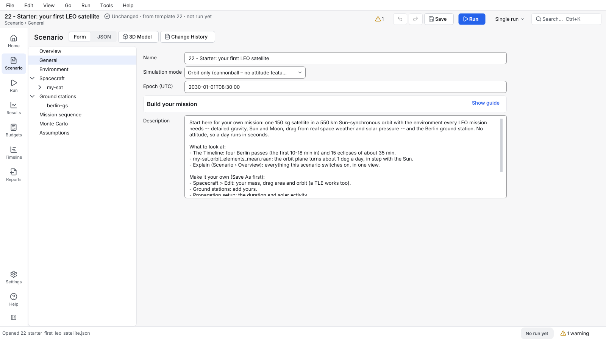

# SpaceMissionStudio

[](https://github.com/0h3xn4/basilisk_space-mission-studio/actions/workflows/spacemissionstudio.yml)


SpaceMissionStudio is a desktop app for satellite mission analysis. You
design a mission in forms, run it and read the results, without code.
[Basilisk](https://avslab.github.io/basilisk/), the astrodynamics
framework of the AVS Lab (University of Colorado Boulder), calculates
every number. SpaceMissionStudio adds the windows, the scenario files,
the plots, the checks and the analyses.



## Install

| System | Get | Install |
|---|---|---|
| Linux x86_64 | The `.deb` from the [releases page](https://github.com/0h3xn4/basilisk_space-mission-studio/releases) | `sudo apt install ./spacemissionstudio_<version>_amd64.deb` |
| Windows 10 or 11, x86_64 | The setup program from the [releases page](https://github.com/0h3xn4/basilisk_space-mission-studio/releases) | Double-click `spacemissionstudio-<version>-setup.exe` |
| From source, Python 3.14 | A clone of this repository | The commands below |

The installers contain Python 3.14, Basilisk 2.12.0 and the reference
data. They need no internet.

To install from source on Linux, use these commands. For Windows, and
for each step, see [Getting started](docs/getting-started.md).

```bash
git clone https://github.com/0h3xn4/basilisk_space-mission-studio.git
cd basilisk_space-mission-studio/SpaceMissionStudio
python3 -m venv .venv
source .venv/bin/activate
pip install "bsk[all]==2.12.0" -e ".[gui]"
spacemissionstudio kernels-status
spacemissionstudio earth-orientation --fetch
spacemissionstudio gui
```

`kernels-status` and `earth-orientation --fetch` download the reference
data one time. If a command says that Basilisk is not installed, activate
the environment and type `pip install "bsk[all]==2.12.0"`.

## Your first mission

1. Start the app. It opens on **Home**.
2. Click the card **22 - Starter: your first LEO satellite**. Then click **Open template**.
3. Click **Run** (`Ctrl+R`). After a few seconds, the **Results** area opens.
4. Open the **Timeline** (`Ctrl+6`). It shows four passes over Berlin.

The next steps are in [Run a template](docs/user-manual/run-a-template.md).

## What you can do

| Area | What | How-to |
|---|---|---|
| Scenarios | A scenario is a JSON file. Edit it in forms, or as text with completion and quick fixes. Start from 47 templates. | [Build your own scenario](docs/user-manual/build-your-own-scenario.md) |
| Orbits | Earth gravity, Sun and Moon, drag from real space weather, solar pressure, measured Earth orientation. Runs of up to about 10 years. | [Orbit keeping and formations](docs/user-manual/orbit-keeping-and-formations.md) |
| Orbit keeping | LEO and GEO station keeping, formations, Walker constellations | [Orbit keeping and formations](docs/user-manual/orbit-keeping-and-formations.md) |
| Maneuvers | Burns, Lambert transfers, reports and conditions in a Mission Sequence | [Mission Sequence](docs/user-manual/mission-sequence.md) |
| Attitude | Pointing modes, star trackers, IMUs, sun sensors, magnetometers, reaction wheels, thrusters, torque rods, navigation errors, flexible arrays | [Attitude and hardware](docs/user-manual/attitude-and-hardware.md) |
| Power, link, data | Battery, radio link margin, onboard data and downlink | [Power, link and data](docs/user-manual/power-link-and-data.md) |
| Budgets | Equipment list, power, mass, pointing error and propellant budgets | [Budgets](docs/user-manual/budgets.md) |
| Lifetime | Orbital lifetime, deorbit, an ESA AD10-style propellant budget | [Lifetime and propellant](docs/user-manual/lifetime-and-budget.md) |
| 3D model | The spacecraft from shapes, `.obj` meshes or an IDM-CIC model, with its mass properties and equipment | [3D model](docs/user-manual/3d-model.md), [IDM-CIC](docs/user-manual/idm-cic.md) |
| Design checks | Fields of view, thrusters, mass budget, launcher fit; disturbance torques, blinding, shading, re-entry | [Model analyses](docs/user-manual/model-analyses.md) |
| Thermal | A thermal model on the 3D model: hot, cold and nominal cases, sweeps, a thermal Monte Carlo | [Thermal analysis](docs/user-manual/thermal.md) |
| Operations | Plans of images, calibrations and passes within the battery, the memory and the slews | [Operations planning](docs/user-manual/operations.md) |
| Monte Carlo | Many runs with dispersed inputs, statistics, requirements with a confidence bound | [Monte Carlo](docs/user-manual/monte-carlo.md) |
| Results | Plots, the Timeline, the 3D View, run comparison, CSV, PNG and SVG; provenance on every output | [Read the results](docs/user-manual/read-the-results.md) |
| Transparency | **Show calculation** beside a number, parameters in a project file, a change history, plugins | [Change a parameter](docs/user-manual/project-configuration.md) |
| Exchange | CCSDS OPM, OMM and OEM files, TLEs, IDM-CIC models (read only) | [Orbit files](docs/user-manual/orbit-files.md) |
| Flight software | Export as a C project; software-in-the-loop tests of your own flight software | [Flight software and SIL](docs/user-manual/flight-software-and-sil.md) |
| Automation | A command line for every analysis, and a Python API | [Command line](docs/user-manual/command-line.md), [Python API](docs/api.md) |
| Offline | Nothing downloads without your consent. No telemetry. | [Reference data](docs/user-manual/reference-data.md) |

[Capabilities and verification](docs/reference/capabilities.md) gives
the Basilisk module of each feature.

## Requirements

| | |
|---|---|
| System | Linux x86_64 or aarch64 with glibc 2.34 or newer; Windows 10 or 11, x86_64 |
| Python | None for the installers. From source: Python 3.14 |
| Basilisk | 2.12.0, in the installers or from PyPI (`bsk`) |
| Disk | About 1.7 GB with the reference data |
| Internet | None for the installers. From source: one time, to install and to get the reference data |

Linux on ARM (aarch64) has no installer: install from source. The
installers and the install scripts are in [`packaging/`](packaging/README.md).

## Where to go next

| To | Read |
|---|---|
| Install, step by step | [Getting started](docs/getting-started.md) |
| Learn the app | [User Manual](USER_MANUAL.md), also in the app (**Help**, `F1`) |
| Do a task | [How-to guides](docs/user-manual/README.md) |
| Learn from examples | [Template catalog](spacemissionstudio/scenarios/templates/README.md), [Python examples](examples/README.md) |
| Solve a problem | [Troubleshooting](docs/troubleshooting.md), [FAQ](docs/faq.md) |
| Find a term | [Glossary](docs/glossary.md) |
| See all documents | [Documentation index](docs/README.md) |
| Contribute | [Contributing](CONTRIBUTING.md), [Developer guide](docs/developer/README.md) |

## Status and licence

- **Version:** 2.16.0 ([release](https://github.com/0h3xn4/basilisk_space-mission-studio/releases/tag/spacemissionstudio-v2.16.0), [changelog](CHANGELOG.md)). The scenario format is version 8. Version 2.15.0 and older cannot open it.
- **Platforms:** the Linux `.deb`, the Windows setup program and the wheel. The release workflow builds, installs and runs the two installers offline ([`packaging/README.md`](packaging/README.md)). CI runs the tests on Linux and Windows. macOS is not supported.
- **Licence:** the European Union Public Licence v. 1.2 (EUPL-1.2, [`LICENSE`](LICENSE), German text [`LICENSE.de`](LICENSE.de)), from the release after 2.6.0. Releases 1.0.0 to 2.6.0 stay under the ISC licence.
- **Basilisk** keeps its ISC licence and its copyright holders. The EUPL covers only the work in `SpaceMissionStudio/`. [`THIRD_PARTY_NOTICES`](THIRD_PARTY_NOTICES) lists each bundled component with its licence.
- **AI authorship:** Claude (Anthropic's AI model) wrote the code, the tests, the documentation, [`HISTORY.md`](HISTORY.md) and the commits, through Claude Code. A person reviewed the work, chose what to build and approved each merge. The person did not write the code or the text.
- **Copyright:** no copyright is claimed in the app's own code, which an AI model wrote. 0h3xn4 publishes it under the EUPL-1.2 as its licensor.
- **Independence:** this is an independent personal project. It is not affiliated with the organisations that its documentation names, and they do not endorse it. Examples are NASA, ESA, the AVS Lab of the University of Colorado Boulder, CNES and The Qt Company.
- **No warranty:** the app is free of charge and has no warranty (EUPL-1.2, Articles 7 and 8). Check its results independently before you use them for a real mission.
- **Known gaps:** [Known limitations](docs/reference/limitations.md).
- **Standards:** the ECSS and CCSDS records are in [`compliance/`](compliance/README.md). They are the project's own records, not a certification.

## Related tools

| Tool | Relation |
|---|---|
| [Basilisk](https://github.com/AVSLab/basilisk) | The simulation engine. This repository is a fork of it. |
| [GMAT](https://sourceforge.net/projects/gmat/) | NASA's mission analysis tool. The tests use it as a reference: time scales, propagation, CCSDS files. |

SpaceMissionStudio has no direct link to other mission tools. It
exchanges data through files: [Tips](docs/tips.md#files-the-app-reads-and-writes)
lists them.

---

**Next:** [Getting started](docs/getting-started.md) ·
[Documentation index](docs/README.md)
